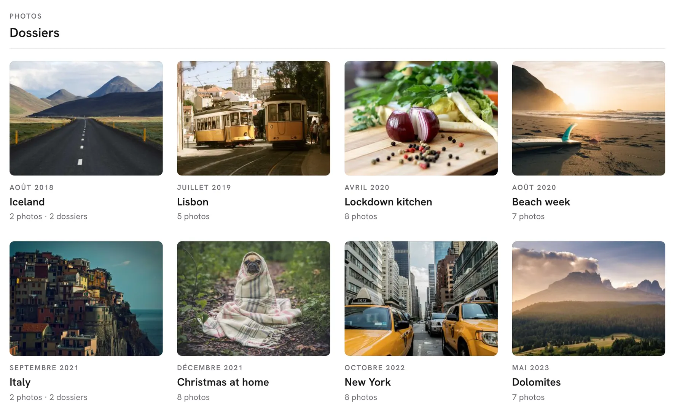

# Blaze Gallery

**You backed up every photo. Now look at them.**

Blaze is a private, self-hosted gallery for the photos already sitting in your Backblaze B2, Cloudflare R2, MinIO or other S3-compatible bucket. It reads the bucket as it is: your folders become albums, the dates your camera wrote become a timeline, and you can share one weekend without opening the rest. Nothing is imported or copied.



[Website](https://sderosiaux.github.io/blaze-gallery/) · [Try the demo](#try-it-on-demo-photos) · [Setup guide](docs/SETUP.md)

The interface is in French for now.

## What you get

- Your folders, as albums. A folder named `2019-07 Lisbon` shows as *Lisbon*, July 2019, with one of its photos on the cover. Sub-folders stay sub-albums.
- A timeline of every dated photo, month by month, with the years in the margin.
- Big folders that stay fast. Tiles on screen load first, the rest follows in order, and opening a folder builds its missing thumbnails once. RAW files (NEF, CR2, ARW, DNG, ORF and more) show the JPEG preview the camera stored inside them.
- A viewer made for looking: a 2048 px copy of each photo is made once and reused, the original is only fetched to zoom past it or to download. Arrows, Space for the slideshow, F to favourite, R and Shift+R to turn a photo, Z to zoom, I for details.
- Search by what a photo shows, not only by its name: « chat sur un canapé » or "beach at sunset" finds the photos, in French or English. Folders and file names still match too.
- People. Name a face on a few photos (P in the viewer), and the worker follows that person across the years, baby pictures included. Faces it isn't sure about wait in a review queue (G yes, X no), and the timeline filters to one person.
- Colours. Browse the library by colour or by tone (black and white, dark, bright, vivid, soft), narrow the timeline, the map or a search to one colour, and see each folder's palette under its cover.
- A map of every photo with a location. Draw a zone, then narrow it to a period.
- Favourites, and a random album when you don't know where to start.
- Upload and delete from the browser, when your storage keys allow writing.

## How your photos stay yours

- Only the email addresses you list can sign in (Google sign-in, `AUTH_EMAIL_WHITELIST`). In production, Blaze refuses requests when sign-in is off, unless you set `ALLOW_PUBLIC_ACCESS=true` on purpose (a laptop, a private network).
- A share link opens one folder: its own photos, not its sub-folders, not a folder with a similar name. You can add a password (hashed with bcrypt; guesses are throttled per address and per link), an end date, and choose whether guests may download. If downloads are off, guests see the 2048 px copies and never the original image files. You can revoke a link at any time.
- Blaze never rewrites your files. Turning a photo or marking a favourite is stored in Postgres. The bucket only changes when you upload, or delete after confirming.
- Storage keys stay on the server. Your own downloads use signed links that expire after an hour.
- No analytics and no tracking. Pages are marked `noindex` and cannot be framed by other sites.
- Faces, colours and content are read on machines you own (a Mac with Apple silicon, or any Linux box with Docker) with open models. No photo is sent to an AI service.
- The MCP endpoint, for AI assistants, needs your session or `API_KEY` as a Bearer token.

What Blaze does not do: there is no end-to-end encryption. The server reads your photos to make thumbnails, like any gallery that shows previews. TLS comes from your host (Vercel, or a reverse proxy in front of Docker).

## Try it on demo photos

Needs Docker with Compose v2. No bucket or account required.

```bash
git clone https://github.com/sderosiaux/blaze-gallery.git
cd blaze-gallery
cp .env.demo .env
docker compose --profile demo up -d --build
```

Then open http://localhost:3100. The first start builds the image and downloads 62 free-licensed photos, so it needs a network connection. The photographers are credited in [demo/CREDITS.md](demo/CREDITS.md).

## Run it on your photos

```bash
cp .env.template .env
# point BACKBLAZE_* at your bucket (any S3-compatible endpoint),
# then set up Google sign-in, or ALLOW_PUBLIC_ACCESS=true on a private network
docker compose up -d --build
```

Open http://localhost:3000. Compose runs PostgreSQL next to the app and creates the tables on start.

- [Setup](docs/SETUP.md): Docker, Node.js without Docker, each storage provider.
- [Configuration](docs/CONFIGURATION.md): every environment variable the code reads.
- [Deployment](docs/DEPLOYMENT.md): a server, Vercel, a reverse proxy, health checks.

## How it works

Blaze lists your bucket into PostgreSQL (folders, files, EXIF dates and dimensions), then serves pages from that index. Originals stay where they are and are read on demand. Thumbnails and 2048 px copies are made the first time they're needed and kept on local disk or in a second bucket (Cloudflare R2 works well: no egress fees).

The analysis is optional. A Python worker (`worker/`) takes jobs from a queue in PostgreSQL, reads the originals, and writes back thumbnails, colours, faces (InsightFace) and an embedding (SigLIP 2) stored with pgvector. Search queries are turned into embeddings by a small HTTPS service on the same machine.

Built with Next.js 14, PostgreSQL with pgvector, sharp and the AWS S3 SDK.

## Contributing

Issues and pull requests are welcome. `npm run check` (strict TypeScript, ESLint and Prettier) has to pass, and CI runs it on every pull request.

## License

[MIT](LICENSE)
